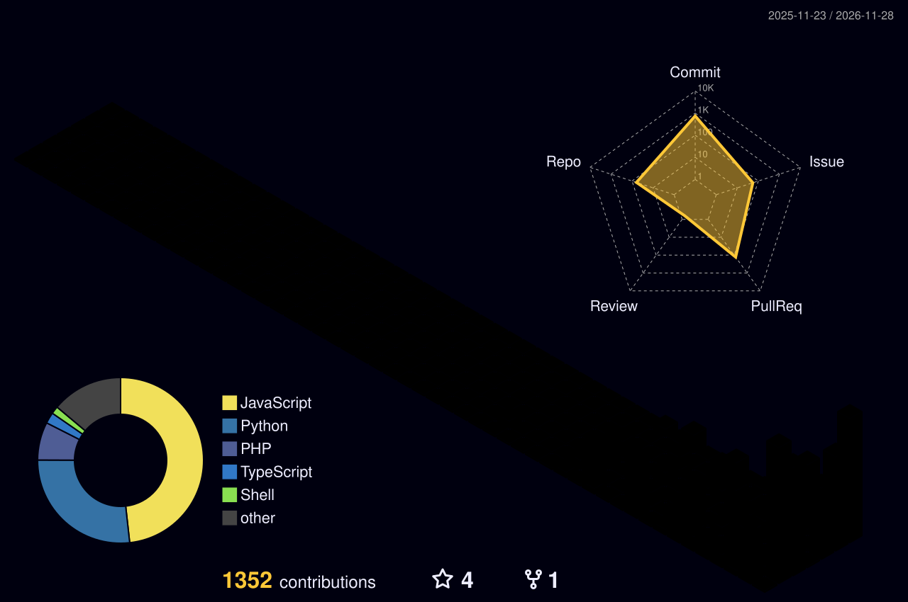

  
  
  
  
  
  

 

## 🙋 关于我

你好，我是 **科技酱**，一个写代码、写文档、偶尔做点开源的人。

同一个世界，同一个互联网。如果你在找技术博客或者开发者社区，可以去 [科技酱的技术文档](https://docs.asoe.cn) 转转。

> 藏技术菁华，见字节山河

组织：[TechnologySauce](https://github.com/TechnologySauce) · [TechsSauce](https://github.com/TechsSauce) · [DDYIT](https://github.com/ddyit)

## 🪄 我正在做什么

<table>
  <tr>
    <th width="22%">方向</th>
    <th>实践内容</th>
  </tr>
  <tr>
    <td>🌐 <b>网站与服务</b></td>
    <td><a href="https://eslibrary.asoe.cn/">精华社 · 藏经阁</a> —— 藏技术菁华，见字节山河；<a href="https://pull-whois.asoe.cn/">Pull Whois</a> —— 域名的每一面，一次看清</td>
  </tr>
  <tr>
    <td>🧩 <b>浏览器插件</b></td>
    <td>已上架 Edge 应用商店：<a href="https://microsoftedge.microsoft.com/addons/detail/nffgadmijjbadebdocdfdfciafefflio">分析</a> · <a href="https://microsoftedge.microsoft.com/addons/detail/ssh/kofjghkemhlgiohodieidnhapeapfgbp">SSH</a></td>
  </tr>
  <tr>
    <td>🤖 <b>AstrBot 插件</b></td>
    <td><a href="https://cloud.astrbot.app/users/ai">AstrBot 插件市场</a>在线维护中</td>
  </tr>
  <tr>
    <td>📦 <b>开源项目</b></td>
    <td><a href="https://github.com/techjiang/SuperEditor">SuperEditor</a> · <a href="https://github.com/techjiang/app-Linglong-Clipboard">玲珑剪切板</a> · <a href="https://github.com/techjiang/JinghuaSociety-ScriptureLibrary">精华社</a> · <a href="https://github.com/techjiang/AdminURL">AdminURL</a></td>
  </tr>
</table>

## 📫 联系我

欢迎交流建站、插件开发与开源项目，也欢迎加入交流群一起折腾：

- 💬 QQ 群：`291974598` ｜ `474819022` ｜ `631167288`
- 🎮 Discord：[科技酱](https://discord.gg/D6CvkR8d8)
- 📮 邮箱：**official@tech.asoe.cn**

## ✨ 代表作

  
  
  
  

## 🚀 GitHub 数据

  <table style="width:100%;">
    <tr>
      <td align="center">
        <picture>
          <source media="(prefers-color-scheme: dark)" srcset="https://github-readme-stats.vercel.app/api?username=techjiang&show_icons=true&hide_border=true&include_all_commits=true&count_private=true&theme=chartreuse-dark&bg_color=0d1117" />
          
        </picture>
      </td>
      <td align="center">
        <picture>
          <source media="(prefers-color-scheme: dark)" srcset="https://github-readme-stats.vercel.app/api/top-langs/?username=techjiang&layout=compact&hide_border=true&bg_color=0d1117&theme=chartreuse-dark" />
          
        </picture>
      </td>
    </tr>
  </table>

 

  <picture>
    <source media="(prefers-color-scheme: dark)" srcset="https://streak-stats.demolab.com?user=techjiang&hide_border=true&background=0d1117&locale=zh_Hans&ring=F76C9B&fire=ff7eb3&currStreakLabel=F76C9B" />
    
  </picture>

## 🧰 技术栈

## 🐍 贡献贪吃蛇

  <picture>
    <source media="(prefers-color-scheme: dark)" srcset="https://raw.githubusercontent.com/techjiang/techjiang/output/github-contribution-grid-snake-dark.svg" />
    
  </picture>

---

  <picture>
    <source media="(prefers-color-scheme: dark)" srcset="profile-3d-contrib/profile-night-rainbow.svg" />
    <source media="(prefers-color-scheme: light)" srcset="profile-3d-contrib/profile-gitblock.svg" />
    
  </picture>

 

  

  

