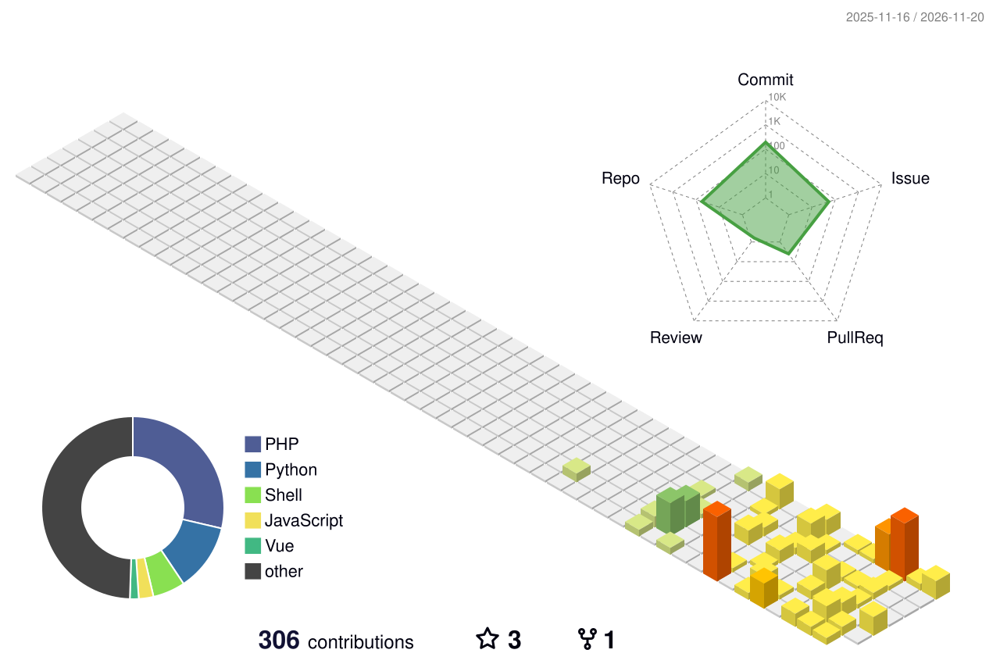

 

<h1 align="center">Hi, I'm 科技酱</h1>

  同一个世界，同一个互联网

  <a href="https://www.asoe.cn">科技酱</a> ·
  <a href="https://docs.asoe.cn">技术文档</a> ·
  <a href="https://space.bilibili.com/1768832152">哔哩哔哩</a> ·
  <a href="mailto:official@tech.asoe.cn">邮箱</a>

  
  
  
  
  

 

我在写代码、写文档，偶尔做点开源。如果你在找技术博客或者开发者社区，可以去 [科技酱的技术文档](https://docs.asoe.cn) 转转。

QQ 交流群：`291974598` ｜ `474819022` ｜ `631167288`   |  Discord：[科技酱](https://discord.gg/D6CvkR8d8)

组织：[TechnologySauce](https://github.com/TechnologySauce) | [TechsSauce](https://github.com/TechsSauce) | [DDYIT](https://github.com/ddyit)

留言：大家好，我是科技酱，欢迎到[我的网站](https://docs.asoe.cn)看看。欢迎加入我的“[精华社 · 藏经阁](https://eslibrary.asoe.cn/)”新项目❤

### 更多+

我上线的[AstrBot插件](https://cloud.astrbot.app/users/ai)，我上线的浏览器插件；[分析(Edge)](https://microsoftedge.microsoft.com/addons/detail/nffgadmijjbadebdocdfdfciafefflio) 和 [SSH(Edge)](https://microsoftedge.microsoft.com/addons/detail/ssh/kofjghkemhlgiohodieidnhapeapfgbp) ❤

<h3 align="center">✨ 网站+</h3>

  <a href="https://pull-whois.asoe.cn/"><b>Pull Whois</b></a> - 域名的每一面，一次看清
   
  <a href="https://eslibrary.asoe.cn/"><b>精华社 · 藏经阁</b></a> - 藏技术菁华，见字节山河
   

 
 

<h3 align="center">✨ 代表作</h3>

  
  
  
  
  
  
  

 

  

 

  <picture>
    <source media="(prefers-color-scheme: dark)" srcset="https://github-readme-stats-fast.vercel.app/api/top-langs/?username=techjiang&layout=compact&hide_border=true&theme=chartreuse-dark&bg_color=0d1117" />
    
  </picture>
  <picture>
    <source media="(prefers-color-scheme: dark)" srcset="https://streak-stats.demolab.com?user=techjiang&hide_border=true&background=0d1117&locale=zh_Hans&ring=F76C9B&fire=ff7eb3&currStreakLabel=F76C9B" />
    
  </picture>

 

  <picture>
    <source media="(prefers-color-scheme: dark)" srcset="https://raw.githubusercontent.com/techjiang/techjiang/output/github-contribution-grid-snake-dark.svg" />
    
  </picture>

 

  <picture>
    <source media="(prefers-color-scheme: dark)" srcset="profile-3d-contrib/profile-night-rainbow.svg" />
    <source media="(prefers-color-scheme: light)" srcset="profile-3d-contrib/profile-season-animate.svg" />
    
  </picture>

 

  

 

  

